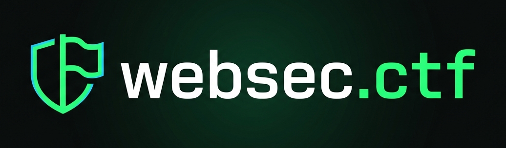
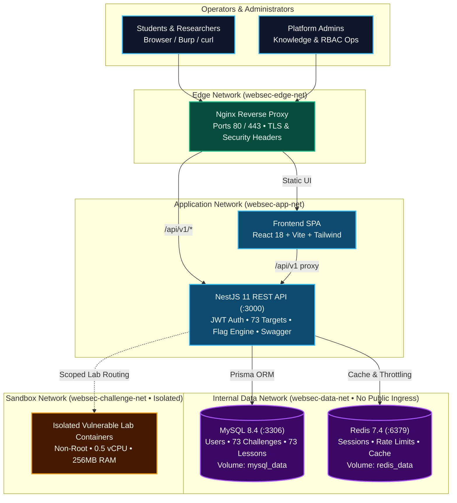
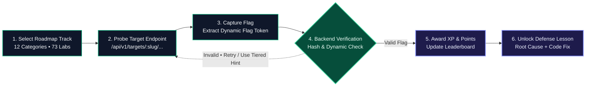

# WebSec CTF — Web Application Penetration Testing Platform

<p align="center">
  
</p>

<p align="center">
  <a href="LICENSE"></a>
  <a href="#"></a>
  <a href="#"></a>
  <a href="#"></a>
  <a href="#"></a>
  <a href="#"></a>
  <a href="#"></a>
  <a href="#"></a>
  <a href="CONTRIBUTING.md"></a>
</p>

<p align="center">
  <strong>A modern, open-source web application penetration testing and cybersecurity training platform featuring 73 live CTF labs and 73 defense lessons aligned with OWASP Top 10, WSTG, ASVS, CWE, CVSS, MITRE ATT&CK, and PTES.</strong>
</p>

---

## 🛡️ Overview

**WebSec CTF** provides a practical, hands-on training ground for security researchers, students, and penetration testers. Operators practice against **73 intentionally vulnerable web targets** across **12 security categories**, capture dynamic flags, receive instant server-side validation, and unlock **73 paired defense & code-remediation lessons**.

### Core Features
- **73 Live Challenges & 73 Defense Guides**: Complete 12-domain curriculum starting from **Web Security Fundamentals** (`HTTP/2`, `SOP`, `CORS`, `RFC 6265 Cookies`, `STRIDE`) up through SQLi, XSS, IDOR, SSRF, JWT, Business Logic, and Insecure Deserialization.
- **Interactive 3-Panel Challenge Workspace**: Mission brief, progressive tiered hints, live vulnerable HTTP target console, and server-side flag verification in one unified interface.
- **Role-Aware Security Architecture**: Dedicated researcher learning workflows plus an **Administrator Command Center** with Knowledge Admin controls, invitation-based admin onboarding, and audit logs ([Read Authentication Guide](docs/AUTHENTICATION.md)).
- **Unlock-by-Exploit Knowledge Library & Snaking Roadmap**: Solving a CTF challenge automatically unlocks its deep-dive root cause analysis, vulnerable vs. patched code comparison, and advances your **12-node Cyber Progress Map**.
- **Server-Side Flag Integrity**: Flags (`websec{...}` / `WEBSEC{...}`) are validated strictly server-side using cryptographic hashes and per-player dynamic derivation—never leaked in client bundles.
- **Zero-Trust Challenge Isolation**: Dedicated Docker lab containers run on an isolated sandbox network (`0.5 vCPU`, `256MB RAM`, non-root user), isolated from the production database.
- **Real-Time Leaderboard & Achievements**: Live global rankings, solve streaks, XP tracking, and 36 cyberpunk anime operator avatars.

---

## 🏛️ System Architecture

WebSec CTF isolates public ingress, application logic, internal databases, and intentionally vulnerable target sandboxes across dedicated Docker bridge networks:



### 🔄 Learning & Flag Capture Workflow



---

## 🎯 73-Challenge & Defense Curriculum Matrix

Every challenge maps **1-to-1** with an interactive security lesson (**73 Challenges + 73 Lessons = 100% Parity**):

| Level | Category | Labs & Lessons | Difficulty Range | Standards & Focus |
|---:|---|---:|---|---|
| **01** | **Web Security Fundamentals** (`Foundations`) | **10** | Beginner – Easy | `A00:2021`, `RFC 6265`, `RFC 9110/9113`, `SOP`, `CORS`, `STRIDE` |
| **02** | **Authentication & Access Control** | **11** | Beginner – Hard | `A01/A07:2021`, `WSTG-ATHN`, `CWE-287`, Session Fixation, MFA |
| **03** | **SQL Injection** | **10** | Beginner – Hard | `A03:2021`, `WSTG-INPV-05`, `CWE-89`, UNION, Boolean/Time Blind |
| **04** | **Cross-Site Scripting (XSS)** | **10** | Beginner – Hard | `A03:2021`, `WSTG-INPV-01`, `CWE-79`, Reflected, Stored, DOM, CSP |
| **05** | **File Handling & Path Traversal** | **10** | Beginner – Hard | `A01:2021`, `CWE-22`, `CWE-434`, LFI, Arbitrary Upload, Zip Slip |
| **06** | **API Security & Server-Side** | **10** | Easy – Hard | `API1–API10:2023`, Mass Assignment, GraphQL, SSTI |
| **07** | **Insecure Direct Object Reference (IDOR)** | **2** | Easy – Medium | `API1:2023`, `CWE-639`, Horizontal & Multi-Tenant BOLA |
| **08** | **Server-Side Request Forgery (SSRF)** | **2** | Medium – Hard | `A10:2021`, `CWE-918`, Cloud Metadata & Internal Pivot |
| **09** | **Command Injection** | **2** | Easy – Medium | `A03:2021`, `CWE-78`, OS Shell Escape & Filter Bypass |
| **10** | **JSON Web Token (JWT)** | **2** | Medium – Hard | `API2:2023`, `CWE-347`, `alg:none` & Key Confusion |
| **11** | **Business Logic Vulnerabilities** | **2** | Medium – Hard | `A04:2021`, `WSTG-BIZ`, Race Conditions & Workflow Tampering |
| **12** | **Insecure Deserialization** | **2** | Hard | `A08:2021`, `CWE-502`, Prototype & Object Gadget Chains |
| — | **Total Platform Curriculum** | **73** | **12 Tracks** | **73 Live Flags + 73 Paired Defense Lessons** |

---

## ⚡ Quickstart Guide (From Clone to Running in 3 Minutes)

WebSec CTF runs out-of-the-box with **Docker Compose**, automatically spinning up MySQL 8.4, Redis, the NestJS Backend API, applying database migrations, seeding **73 challenges + 73 defense guides**, and serving the React Frontend via Nginx.

> 📖 **Full Beginner Walkthrough**: See our dedicated [**QUICKSTART.md**](QUICKSTART.md) for detailed step-by-step guidance and troubleshooting.

### 📋 Prerequisites
- **[Git](https://git-scm.com/)**
- **Docker** ([Docker Desktop](https://www.docker.com/products/docker-desktop/) on Windows/Mac, or `docker.io` on Linux/Kali)

### 💻 Step-by-Step Instructions

```bash
# Step 1: Clone the repository
git clone https://github.com/Sekthorn/CTF-Platform-.git
cd CTF-Platform-

# Step 2: Copy the configuration template
# On Linux / macOS / Kali:
cp .env.example .env

# On Windows (PowerShell):
Copy-Item .env.example .env

# Step 3: Launch the platform
# On Windows / macOS / Ubuntu:
docker compose up -d --build

# On Kali Linux (if using Podman, enable socket first):
# systemctl --user enable --now podman.socket
# docker compose up -d --build
```

### 💾 Local Resource & Storage Requirements

| Setup Mode | Cloned Repo | Dependencies / Images | Recommended Free Disk | Recommended RAM |
|---|---:|---:|---:|---:|
| **Node.js + Local MySQL** | ~25 MB | ~617 MB (`node_modules` + `dist`) | **2–3 GB** | 4–8 GB |
| **Docker Compose Full Stack** | ~25 MB | ~2.5–4.5 GB (MySQL, Redis, Node, Nginx, Labs) | **8–10 GB** | 4–8 GB |

### 🌐 Accessing the Platform
Once the command finishes, open your browser:
- **Web Application & UI**: [http://localhost](http://localhost) (Port 80)
- **Backend REST API**: [http://localhost/api/v1](http://localhost/api/v1) (or direct: `http://localhost:3000/api/v1`)
- **Swagger OpenAPI Docs**: [http://localhost/api/v1/docs](http://localhost/api/v1/docs)
- **Service Health Check**: [http://localhost/api/v1/health](http://localhost/api/v1/health)

### 🔐 Default Pre-Seeded Accounts

| Role | Username | Email / Login | Password | Purpose |
|---|---|---|---|---|
| **Student / Researcher** | `student_hacker` | `student@websec.ctf` | `StudentPass2026!` | Solve challenges, submit flags, read security dossiers |
| **Root Administrator** | `admin` | `admin@websec.ctf` | `AdminSecurePass2026!` | Platform management, metrics, and administration |

---

## 🛠️ Managing the Application

### Check Running Services & Logs
```bash
# View running container status
docker compose ps

# View live logs for all services
docker compose logs -f

# View backend initialization & migration logs
docker compose logs -f backend
```

### Stopping Services (Preserves Database)
```bash
docker compose down
```
> [!NOTE]
> Running `docker compose down` stops the containers while keeping the database volume (`mysql_data`) completely safe. Running `docker compose up -d` will immediately restore your database state.

### 🔄 Updating to the Latest Version
When new challenges, security lessons, or features are pushed to GitHub, existing users can update with two commands:
```bash
# 1. Pull the latest code updates
git pull origin main

# 2. Rebuild and restart services
docker compose up -d --build
```
*(Your solved flags, scores, and registered user accounts will remain completely safe).*

### Resetting the Database (Fresh Start)
> [!CAUTION]
> **Data Loss Warning**: The following command deletes all MySQL challenge progress, user accounts, and score logs!
```bash
docker compose down -v
docker compose up -d --build
```

---

## 🚀 Production VPS Deployment

Deploy onto an Ubuntu / Debian VPS in 3 minutes:

```bash
# 1. Clone repository
git clone https://github.com/Sekthorn/CTF-Platform-.git /opt/websec-ctf
cd /opt/websec-ctf

# 2. Configure environment secrets
cp .env.example .env
nano .env # Set strong passwords and JWT secrets

# 3. Launch hardened production stack
docker compose -f docker-compose.prod.yml up -d --build
```

For complete instructions including domain DNS and Let's Encrypt SSL/TLS certificates, read the [Production VPS Deployment Guide](docs/deployment-guide.md).

---

## 📁 Repository Structure

```
.
├── .github/                 # Issue templates, PR template & GitHub Actions CI
├── backend/                 # NestJS 11 REST API, Prisma ORM, 73 Challenges & Lessons, Swagger
├── frontend/                # React 18, Vite, Tailwind CSS, shadcn/ui, 12-Tier Roadmap UI
├── challenges/              # Vulnerable challenge containers & author template
├── infrastructure/          # Nginx reverse proxy configs & SSL cert management
├── scripts/                 # Onboarding, backup, restore, and scaffolding scripts
├── docs/                    # Architecture, deployment, and challenge authoring guides
├── docker-compose.yml       # Development orchestration
├── docker-compose.prod.yml  # Hardened production orchestration
└── README.md
```

---

## 💾 Database Backups & Restorations

### Backup
```bash
# Linux / macOS:
./scripts/backup-db.sh

# Windows:
.\scripts\backup-db.ps1
```

### Restore
```bash
# Linux / macOS:
./scripts/restore-db.sh backups/websec_ctf_backup_YYYYMMDD_HHMMSS.sql.gz

# Windows:
.\scripts\restore-db.ps1 -BackupFile backups\websec_ctf_backup_YYYYMMDD_HHMMSS.sql
```

---

## 🤝 Contributing

We welcome contributions of all forms:
- Authoring new vulnerable lab scenarios.
- Adding OWASP / CWE learning references.
- Improving UI/UX accessibility.
- Patching bugs.

Please read our [Contributing Guidelines](CONTRIBUTING.md) and [Challenge Authoring Guide](docs/challenge-development.md).

---

## 🔒 Security Policy

Please read our [Security Policy](SECURITY.md) for vulnerability disclosure procedures. Report security vulnerabilities to `security@websec.ctf`.

---

## 👨‍💻 Author & Copyright

**WebSec CTF** is designed, architected, and developed by:
- **Creator & Lead Developer**: **SEK Thorn** ([@Sekthorn](https://github.com/Sekthorn))
- **Copyright**: © 2026 **SEK Thorn**. All rights reserved.

---

## 📄 License

This project is licensed under the [MIT License](LICENSE) — see the [LICENSE](LICENSE) file for details.  
Copyright (c) 2026 SEK Thorn. All rights reserved.
