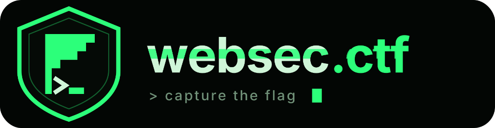

# WebSec CTF — Web Application Penetration Testing Platform

<p align="center">
  
</p>

<p align="center">
  <a href="LICENSE"></a>
  <a href="#"></a>
  <a href="#"></a>
  <a href="#"></a>
  <a href="#"></a>
  <a href="#"></a>
  <a href="CONTRIBUTING.md"></a>
</p>

<p align="center">
  <strong>A modern, open-source web application penetration testing and cybersecurity training platform aligned with OWASP Top 10, WSTG, ASVS, and CWE.</strong>
</p>

---

## 🛡️ Overview

**WebSec CTF** provides a practical, hands-on training ground for security researchers, students, and penetration testers. Players practice against intentionally vulnerable target scenarios, submit captured flags, receive instant automated feedback, and master remediation techniques.

### Core Features:
- **Admin-Only Authentication & Single Sign-On (SSO)**: Strict administrator-only portal with centralized session management, protected invitations, and initial setup wizard ([Read Authentication Guide](docs/AUTHENTICATION.md)).
- **Interactive 3-Panel Challenge Workspace**: Detailed briefs, tactical hints with reveal penalties, live target environments, and cryptographic flag validation in one unified view.
- **Curated Learning Roadmaps**: Structured offensive curricula covering SQL Injection, XSS, Authentication Flaws, Access Control (IDOR), API Security, and Server-Side vulnerabilities.
- **Zero Flag Leakage**: Flags are stored strictly as SHA-256 hashes server-side. Flags are never present in client bundles or public APIs.
- **Zero-Trust Challenge Isolation**: Target lab containers run in restricted sandbox bridge networks with strict CPU and memory limits, completely isolated from the production database.
- **Global Leaderboard & Hall of Fame**: Scoreboard with real-time rankings and anti-cheat duplicate solve protection.
- **Self-Hosting Ready**: Run locally or on any Linux VPS with one single Docker Compose command.

---

## 🏛️ System Architecture

```
[ Students / Researchers ] 
           │
           ▼
[ Nginx Reverse Proxy / Port 80 & 443 ]
           │
     ┌─────┴───────────────────────┐
     ▼                             ▼
[ Frontend (React + Vite) ]   [ Backend API (NestJS 11) ]
                                   │
                             ┌─────┴─────┐
                             ▼           ▼
                      [ MySQL 8.4 ]   [ Redis 7.4 ]
                             │
                      (mysql_data)
```

---

## ⚡ Quickstart Guide (From Clone to Running in 3 Minutes)

WebSec CTF runs out-of-the-box with **Docker Compose**, automatically spinning up MySQL 8.4, Redis, the NestJS Backend API, applying database migrations, seeding 63 challenges + 63 defense guides, and serving the React Frontend via Nginx.

> 📖 **Full Beginner Walkthrough**: See our dedicated [**QUICKSTART.md**](QUICKSTART.md) for detailed step-by-step guidance and troubleshooting.

### 📋 Prerequisites:
- **[Git](https://git-scm.com/)**
- **Docker** ([Docker Desktop](https://www.docker.com/products/docker-desktop/) on Windows/Mac, or `docker.io` on Linux/Kali)

### 💻 Step-by-Step Instructions:

```bash
# Step 1: Clone the repository
git clone https://github.com/Sekthorn/CTF-Platform-.git
cd CTF-Platform-

# Step 2: Copy the configuration template
# On Linux / macOS / Kali:
cp .env.example .env

# On Windows (PowerShell):
Copy-Item .env.example .env

# Step 3: Launch the platform
# On Windows / macOS / Ubuntu:
docker compose up -d --build

# On Kali Linux (if using Podman, enable socket first):
# systemctl --user enable --now podman.socket
# docker compose up -d --build
```

### 🌐 Accessing the Platform:
Once the command finishes, open your browser:
- **Web Application & UI**: [http://localhost](http://localhost) (Port 80)
- **Backend REST API**: [http://localhost/api/v1](http://localhost/api/v1) (or direct: `http://localhost:3000/api/v1`)
- **Swagger OpenAPI Docs**: [http://localhost/api/v1/docs](http://localhost/api/v1/docs)
- **Service Health Check**: [http://localhost/api/v1/health](http://localhost/api/v1/health)

### 🔐 Default Pre-Seeded Accounts:

| Role | Username | Email / Login | Password | Purpose |
|---|---|---|---|---|
| **Student / Researcher** | `student_hacker` | `student@websec.ctf` | `StudentPass2026!` | Solve challenges, submit flags, read security dossiers |
| **Root Administrator** | `admin` | `admin@websec.ctf` | `AdminSecurePass2026!` | Platform management, metrics, and administration |

---

## 🛠️ Managing the Application

### Check Running Services & Logs:
```bash
# View running container status
docker compose ps

# View live logs for all services
docker compose logs -f

# View backend initialization & migration logs
docker compose logs -f backend
```

### Stopping Services (Preserves Database):
```bash
docker compose down
```
> [!NOTE]
> Running `docker compose down` stops the containers while keeping the database volume (`mysql_data`) completely safe. Running `docker compose up -d` will immediately restore your database state.

### 🔄 Updating to the Latest Version:
When new challenges, security lessons, or features are pushed to GitHub, existing users can update with two commands:
```bash
# 1. Pull the latest code updates
git pull origin main

# 2. Rebuild and restart services
docker compose up -d --build
```
*(Your solved flags, scores, and registered user accounts will remain completely safe).*

### Resetting the Database (Fresh Start):
> [!CAUTION]
> **Data Loss Warning**: The following command deletes all MySQL challenge progress, user accounts, and score logs!
```bash
docker compose down -v
docker compose up -d --build
```

---

## 🚀 Production VPS Deployment

Deploy onto an Ubuntu / Debian VPS in 3 minutes:

```bash
# 1. Clone repository
git clone https://github.com/Sekthorn/CTF-Platform-.git /opt/websec-ctf
cd /opt/websec-ctf

# 2. Configure environment secrets
cp .env.example .env
nano .env # Set strong passwords and JWT secrets

# 3. Launch hardened production stack
docker compose -f docker-compose.prod.yml up -d --build
```

For complete instructions including domain DNS and Let's Encrypt SSL/TLS certificates, read the [Production VPS Deployment Guide](docs/deployment-guide.md).

---

## 📁 Repository Structure

```
.
├── .github/                 # Issue templates, PR template & GitHub Actions CI
├── backend/                 # NestJS 11 REST API, Prisma ORM, JWT Auth, Swagger
├── frontend/                # React 18, Vite, Tailwind CSS, shadcn/ui
├── challenges/              # Vulnerable challenge containers & author template
├── infrastructure/          # Nginx reverse proxy configs & SSL cert management
├── scripts/                 # Onboarding, backup, restore, and scaffolding scripts
├── docs/                    # Architecture, deployment, and challenge authoring guides
├── docker-compose.yml       # Development orchestration
├── docker-compose.prod.yml  # Production orchestration
└── README.md
```

---

## 💾 Database Backups & Restorations

### Backup:
```bash
# Linux / macOS:
./scripts/backup-db.sh

# Windows:
.\scripts\backup-db.ps1
```

### Restore:
```bash
# Linux / macOS:
./scripts/restore-db.sh backups/websec_ctf_backup_YYYYMMDD_HHMMSS.sql.gz

# Windows:
.\scripts\restore-db.ps1 -BackupFile backups\websec_ctf_backup_YYYYMMDD_HHMMSS.sql
```

---

## 🤝 Contributing

We welcome contributions of all forms:
- Authoring new vulnerable lab scenarios.
- Adding OWASP / CWE learning references.
- Improving UI/UX accessibility.
- Patching bugs.

Please read our [Contributing Guidelines](CONTRIBUTING.md) and [Challenge Authoring Guide](docs/challenge-development.md).

---

## 🔒 Security Policy

Please read our [Security Policy](SECURITY.md) for vulnerability disclosure procedures. Report security vulnerabilities to `security@websec.ctf`.

---

## 👨‍💻 Author & Copyright

**WebSec CTF** is designed, architected, and developed by:
- **Creator & Lead Developer**: **SEK Thorn** ([@Sekthorn](https://github.com/Sekthorn))
- **Copyright**: © 2026 **SEK Thorn**. All rights reserved.

---

## 📄 License

This project is licensed under the [MIT License](LICENSE) — see the [LICENSE](LICENSE) file for details.  
Copyright (c) 2026 SEK Thorn. All rights reserved.
